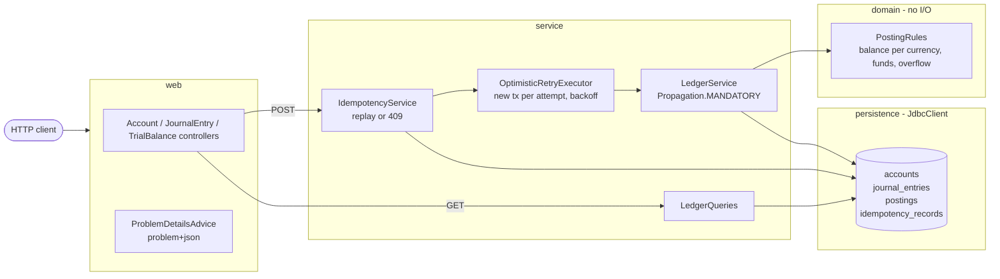

# double-entry-ledger

[](https://github.com/rahulkumar96t/double-entry-ledger/actions/workflows/ci.yml)

A double-entry accounting ledger as a Spring Boot 3 / Java 21 REST service. Every change to money is a
journal entry whose postings sum to zero per currency, amounts are integer minor units (never floating
point), balances are updated with optimistic locking and automatic retry, and every write can be made
safe to retry with an `Idempotency-Key`. The test suite fires hundreds of parallel transfers at a real
embedded server and then audits the database: no lost updates, no overdrafts, and every currency still
nets to zero.

This is a reference implementation for learning and discussion, not a production system (see
[Limitations](#limitations-and-roadmap)).

## Features

- **Accounts** of type `ASSET`, `LIABILITY`, `EQUITY`, `REVENUE`, `EXPENSE`, each in one ISO-4217
  currency. The response includes the currency's minor units (EUR 2, JPY 0, KWD 3) and the account's
  normal balance side.
- **Journal entries** with 2–100 postings. Postings must balance to zero *per currency*, so a currency
  conversion is one entry with an EUR leg and a USD leg.
- **Transfers**: shorthand for a two-posting entry that credits the source and debits the destination.
- **Overdraft protection**: unless `allowNegativeBalance` is set, a posting may not push an account below
  zero in its natural direction (for example, a liability may not end up with a debit balance).
- **Balances**: the current balance, or the balance **as of any instant** (the sum of postings up to it).
- **Account statements** with keyset (cursor) pagination. Each line carries `balanceAfter`, the running
  balance.
- **Idempotency-Key** on every POST:
  - the same key with the same payload replays the stored response byte for byte, with
    `Idempotent-Replayed: true`;
  - the same key with a different payload returns `409`.
- **Optimistic locking** on balances: a compare-and-set on a `version` column. A transaction that loses a
  race is re-run from scratch, with jittered exponential backoff.
- **Errors** are `application/problem+json` (RFC 9457, formerly RFC 7807). Each has a stable `type` such as
  `/problems/insufficient-funds`, plus machine-readable fields.
- **Strict input**: floats, numeric strings and unknown fields are rejected, so `12.5` is never silently
  rounded to `12`.
- **Infrastructure**: Flyway migrations, a springdoc OpenAPI document with Swagger UI, and Micrometer
  counters for retries and replays.
- **Databases**: PostgreSQL for running (via docker-compose); H2 in PostgreSQL mode for tests, so the tests
  need no Docker.

## Architecture



A write goes through three layers:

1. `IdempotencyService` checks for a stored response. If there is none, it asks `OptimisticRetryExecutor`
   to run the work in a fresh transaction.
2. Inside that transaction, `LedgerService`:
   - loads the accounts;
   - runs every rule in `PostingRules` before writing anything;
   - updates each balance with `UPDATE … WHERE id = ? AND version = ?`, in ascending account-id order so
     that concurrent entries cannot deadlock;
   - inserts the entry and its postings.
3. Back in the same transaction, the idempotency record is written. If any version check fails, the whole
   transaction rolls back and the attempt starts over, re-reading every account.

Schema (Flyway, `src/main/resources/db/migration`):

| table | purpose |
|---|---|
| `accounts` | type, currency, `balance` (debit-positive minor units), `version` |
| `journal_entries` | id, description, `posted_at` |
| `postings` | append-only legs: `amount`, `balance_after`, identity `id` used as the statement cursor; `UNIQUE (entry_id, account_id)` |
| `idempotency_records` | key, operation, SHA-256 of the canonical request, stored status, body and `Location` |

## Quickstart

Requirements: JDK 21+. Docker is only needed for the local PostgreSQL.

```bash
docker compose up -d          # PostgreSQL 16 on localhost:5432 (db/user/password: ledger)
./mvnw spring-boot:run        # Flyway migrates, API on http://localhost:8080
```

- **Point at another database:** set `LEDGER_DB_URL`, `LEDGER_DB_USER` and `LEDGER_DB_PASSWORD`. `PORT`
  changes the HTTP port.
- **API docs:** Swagger UI is at <http://localhost:8080/swagger-ui.html>, the OpenAPI JSON at `/v3/api-docs`.
- **Operations:** health is at `/actuator/health`, metrics at `/actuator/metrics`.

Run the tests (no Docker needed):

```bash
./mvnw verify
```

## Usage

Amounts are integers in minor units (`10000` = 100.00 EUR). The examples below were captured from a local
run against PostgreSQL 14; ids are shortened.

```bash
# Open accounts
curl -s -XPOST localhost:8080/api/v1/accounts -H 'Content-Type: application/json' \
  -d '{"code":"equity:capital","name":"Owner capital","type":"EQUITY","currency":"EUR"}'
curl -s -XPOST localhost:8080/api/v1/accounts -H 'Content-Type: application/json' \
  -d '{"code":"assets:wallet:alice","name":"Alice wallet","type":"ASSET","currency":"EUR"}'

# Fund Alice from capital (credit capital, debit Alice)
curl -s -XPOST localhost:8080/api/v1/transfers -H 'Content-Type: application/json' \
  -d '{"fromAccountId":"<capital>","toAccountId":"<alice>","currency":"EUR","amount":10000,"description":"Initial funding"}'
```

```json
{"id":"68a27a3c-…","description":"Initial funding","postedAt":"2026-10-30T11:30:54.235541Z",
 "postings":[{"accountId":"6a596924-…","currency":"EUR","amount":-10000,"balanceAfter":-10000},
             {"accountId":"09c0475d-…","currency":"EUR","amount":10000,"balanceAfter":10000}]}
```

A multi-leg entry that balances per currency:

```bash
curl -s -XPOST localhost:8080/api/v1/journal-entries -H 'Content-Type: application/json' -d '{
  "description": "Invoice 2026-001 paid (19% VAT)",
  "postings": [
    {"accountId":"<bank>",  "currency":"EUR", "amount": 11900},
    {"accountId":"<sales>", "currency":"EUR", "amount":-10000},
    {"accountId":"<vat>",   "currency":"EUR", "amount": -1900}
  ]}'
```

Idempotent retries:

```bash
# Sent twice with the same key: one transfer, two identical 201 responses
curl -si -XPOST localhost:8080/api/v1/transfers -H 'Content-Type: application/json' \
  -H 'Idempotency-Key: 6f1c7d0e-rent-2026-10' \
  -d '{"fromAccountId":"<alice>","toAccountId":"<bob>","currency":"EUR","amount":2500}'
# HTTP/1.1 201
# Location: /api/v1/journal-entries/04946690-…
# Idempotent-Replayed: true        <- second response only
```

Errors are problem details:

```json
{"type":"/problems/insufficient-funds","title":"Insufficient funds","status":422,
 "detail":"Account 09c0475d-… has 7500 available but the posting needs 999999",
 "instance":"/api/v1/transfers","accountId":"09c0475d-…","available":7500,"requested":999999}

{"type":"/problems/unbalanced-entry","title":"Journal entry does not balance","status":422,
 "detail":"Postings must sum to zero per currency; off by {EUR=-1}",
 "instance":"/api/v1/journal-entries","imbalances":{"EUR":-1}}

{"type":"/problems/idempotency-key-reused","title":"Idempotency-Key reused with a different request",
 "status":409,"detail":"Idempotency-Key '6f1c7d0e-rent-2026-10' was already used for a different request",
 "instance":"/api/v1/transfers"}
```

Balances and statements:

```bash
curl -s 'localhost:8080/api/v1/accounts/<alice>/balance'                          # current
curl -s 'localhost:8080/api/v1/accounts/<alice>/balance?asOf=2026-10-01T00:00:00Z' # historical
curl -s 'localhost:8080/api/v1/accounts/<alice>/statement?limit=50'               # follow nextCursor
curl -s 'localhost:8080/api/v1/trial-balance'
# {"balanced":true,"currencies":[{"currency":"EUR","debitTotal":10000,"creditTotal":10000,"net":0,"accounts":3}]}
```

| Method | Path | Notes |
|---|---|---|
| POST | `/api/v1/accounts` | 201 + `Location`; `Idempotency-Key` supported |
| GET | `/api/v1/accounts/{id}` | includes `balance`, `naturalBalance`, `version` |
| GET | `/api/v1/accounts/{id}/balance?asOf=` | `asOf` optional, ISO-8601 instant, inclusive |
| GET | `/api/v1/accounts/{id}/statement?cursor=&limit=` | oldest first, `limit` 1–500 (default 50) |
| POST | `/api/v1/journal-entries` | 2–100 postings, debit-positive amounts |
| GET | `/api/v1/journal-entries/{id}` | |
| POST | `/api/v1/transfers` | `fromAccountId` is credited, `toAccountId` is debited |
| GET | `/api/v1/trial-balance` | per-currency debit and credit totals; `net` must be 0 |

## Design decisions and trade-offs

- **Signed, debit-positive amounts.**
  - Storing one signed `long` per posting makes "balanced" a plain `sum == 0` per currency, and makes the
    global invariant a single `SUM(balance) GROUP BY currency`.
  - The API also returns `naturalBalance` and `normalBalance`, so a funded liability reads as a positive
    number.
- **`long` minor units with explicit bounds.**
  - A single posting is capped at |10^15|, so a 100-leg entry cannot overflow while it is being validated.
  - Balance updates use `Math.addExact`.
  - Jackson is configured to reject floats and numeric strings rather than coerce them.
- **Optimistic, not pessimistic, locking.**
  - A transfer reads the accounts without locks, checks the rules, then does a version compare-and-set.
    Losing a race means the transaction rolls back and is re-run with fresh data.
  - Advantage: no `SELECT … FOR UPDATE` held while rules run, and the retry loop is explicit and testable.
  - Cost: wasted work under contention. In the concurrency test, 660 requests over 9 accounts from 16
    threads caused 531–572 retries on H2 (3 runs) and 689 on PostgreSQL 14 (1 run). A pessimistic lock or a
    queue per hot account would avoid that.
  - Accounts are always updated in ascending id order, so concurrent entries do not deadlock on account
    rows. A deadlock or serialization error reported by the database would be retried anyway.
- **Retrying the whole transaction, not the statement.**
  - `OptimisticRetryExecutor` refuses to run inside an outer transaction (a retry there would re-read
    nothing).
  - `LedgerService` is `Propagation.MANDATORY`, so it cannot be called without one.
- **Idempotency records share the ledger transaction.**
  - The stored response exists if and only if the ledger change committed.
  - Two concurrent requests with the same key race on the primary key. The loser rolls back and replays
    the winner's response; if the winner is still running after 2 s, the loser gets `409` with
    `Retry-After`.
  - Only successful (2xx) outcomes are stored. A request rejected with 422 (for example, insufficient funds)
    leaves no record, so the client can fix the cause and retry with the same key. This differs from APIs
    that also cache errors; it is a deliberate choice.
- **Canonical request fingerprint.**
  - The hash covers the parsed request re-serialised with sorted keys, plus the operation name.
  - Whitespace and field order do not matter. Reusing a key on a different endpoint is a conflict.
- **`balance_after` on every posting** makes statements self-auditing (each line equals the previous line
  plus the amount). The concurrency test checks exactly that.
- **Balance as of a timestamp** is `SUM(amount) WHERE posted_at <= asOf`, served by an
  `(account_id, posted_at)` index. A periodic balance snapshot would bound that scan for long histories
  (see the roadmap).
- **JdbcClient instead of JPA.** The SQL that matters (the version CAS, keyset pagination, aggregates) is
  visible and portable between PostgreSQL and H2's PostgreSQL mode.
- **H2 for tests, PostgreSQL for CI and running.**
  - Every test runs on H2 with no Docker.
  - Setting `LEDGER_IT_JDBC_URL` points the same suite at a real PostgreSQL. CI does this with a
    PostgreSQL 16 service container, and it was run locally against PostgreSQL 14.

## Testing

```bash
./mvnw verify                                   # Spotless (palantir-java-format) check + all tests on H2
LEDGER_IT_JDBC_URL=jdbc:postgresql://localhost:5432/ledger \
LEDGER_IT_JDBC_USER=ledger LEDGER_IT_JDBC_PASSWORD=ledger ./mvnw verify   # same suite on PostgreSQL
```

108 tests (JUnit 5, AssertJ, MockMvcTester):

- **`PostingRulesTest`**: the bookkeeping rules in isolation.
  - Balance per currency, including an FX entry, and rejection of entries that only balance across
    currencies.
  - Zero and out-of-range amounts, duplicate accounts, non-ISO and minor-unit-less currencies (`XAU`).
  - Overdraft rules for each account type, and overflow.
  - A seeded randomized check: 500 random balanced entries pass, and nudging any one leg by one minor unit
    fails.
- **`OptimisticRetryExecutorTest`**: retries in fresh transactions, gives up after max attempts, never
  retries business errors, refuses nested transactions, and classifies PostgreSQL and H2 concurrency
  errors.
- **API tests** (`AccountApiTest`, `JournalEntryApiTest`, `BalanceAndStatementApiTest`), using MockMvc:
  - status codes, `Location` headers and problem+json bodies;
  - validation errors listed per field, and integer-only amounts;
  - as-of balances with a controllable clock, and cursor pagination across pages;
  - the trial balance and the OpenAPI document.
- **`IdempotencyApiTest`**:
  - replays are byte-identical;
  - field order is irrelevant;
  - a different payload, or a different endpoint, gives 409;
  - failed requests are retryable;
  - malformed keys give 400.
- **`ConcurrentTransfersTest`**, over real HTTP against the embedded Tomcat with 16 threads:
  - **Random transfers:** 600 random transfers across 6 EUR and 3 JPY accounts, 10 % of them submitted
    twice with the same key. Afterwards:
    - every balance equals its opening balance plus exactly the acknowledged transfers;
    - each account's `balance_after` chain is unbroken and never negative;
    - no key produced two entries;
    - every currency in the whole database sums to zero.
  - **Double spend:** 50 simultaneous withdrawals of 100 from an account holding 1,000 give exactly 10
    successes and 40 `insufficient-funds` responses.
  - **Same key:** 12 simultaneous requests with one key create exactly one entry.

To check that the concurrency tests can actually fail, the `AND version = :version` predicate was
removed as a deliberate bug. Both the random-transfer test and the double-spend test then failed with lost
updates.

On an Apple M4 Pro (macOS 27.2, JDK 24, compiled with `--release 21`), `./mvnw -q verify` took 6–8 s
wall-clock with a warm Maven cache (13 s on the first run). This is a measure of the suite's runtime, not a
benchmark of the service.

## Limitations and roadmap

- **Not production-hardened:**
  - no authentication or authorization, multi-tenancy, rate limiting or audit log of API callers;
  - idempotency records are never expired (a scheduled purge on `created_at` is the obvious next step).
- **Hot accounts serialize:**
  - Every posting to one account goes through its single version counter, so throughput on that account
    is bounded by commit latency, and retries grow with contention.
  - Possible fixes: sharded sub-accounts, or batching postings to the account.
- **As-of balances:**
  - The scan grows with history; periodic balance checkpoints would bound it.
  - `posted_at` comes from the application clock when the transaction starts, so an as-of query for the
    last few milliseconds can still change while in-flight transactions commit.
- **Immutable entries:** there is no reversal or void endpoint yet. The accounting answer is a
  compensating entry, which the API already supports manually.
- **Database-enforced balance:** the "entry sums to zero" rule is enforced in the application. A
  PostgreSQL deferred constraint trigger could enforce it in the database too, but it is not portable to
  H2.
- **Untested locally:** the `docker-compose.yml` path (no Docker CLI on the build machine). The service
  itself was run against a local PostgreSQL 14 instead, which is where the examples above come from.
